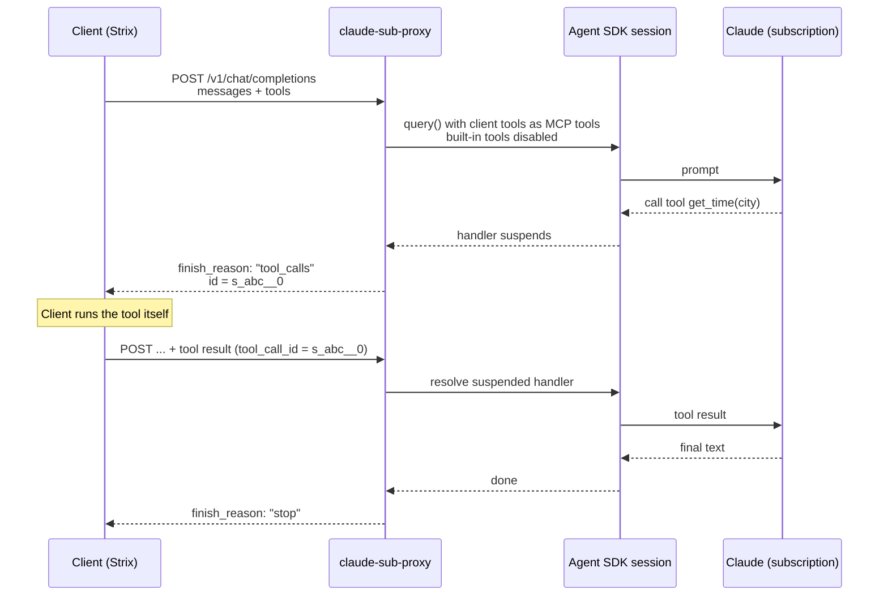
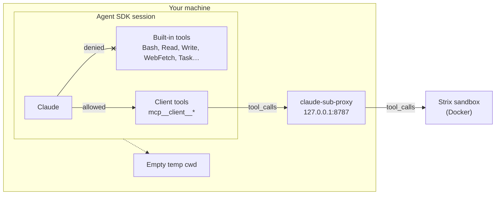

# claude-sub-proxy

A local, OpenAI-compatible `/v1/chat/completions` endpoint backed by the
**Claude Agent SDK**, so that tools which only speak the OpenAI API can use
Claude through your **Claude subscription** instead of a metered
`ANTHROPIC_API_KEY`.

This fork is used to run the [Strix](https://github.com/usestrix/strix) security
agent against Claude. It is hardened for that use: Claude Code's built-in tools
are disabled, so the model can only call the tools the client sends.

> Forked from [cramt/claude-sub-proxy](https://github.com/cramt/claude-sub-proxy),
> originally built for Hermes Agent.

## How it works

The Agent SDK is an *agent*: it runs its own tool loop and only returns final
text. An OpenAI client such as Strix expects the opposite contract: "tell me
which tool to call, I run it, I send you the result" (`tool_calls`).

The proxy bridges the two:

1. The client's `tools` are registered as in-process MCP tools on a fresh SDK
   `query()` session.
2. When Claude calls one of them, the handler does **not** execute anything. It
   suspends the SDK loop and the proxy returns an OpenAI `tool_calls` response.
   Each call id is `<sessionId>__<n>`, so the next request can find the session.
3. The client runs the tool on its side (for Strix: inside its Docker sandbox)
   and posts the result back as a `tool` message.
4. The proxy resolves the suspended handler, the **same** Claude session
   resumes, and returns the next `tool_calls` or the final answer.



### Security boundary

Strix sends untrusted code to the model (the repository it scans). A prompt
injection in that code must not reach your machine. The proxy enforces this:



- `tools: []` and `disallowedTools` disable every Claude Code built-in tool.
- `canUseTool` denies any tool outside the client's passthrough set.
- The SDK runs in an empty temporary directory with `settingSources: []`, so no
  `CLAUDE.md`, local settings or project files are loaded.
- The proxy binds to `127.0.0.1` and requires a bearer token (`API_KEY`).
- Requests are not written to disk.

`test-claude-sub-proxy.sh` checks these guarantees before you run a scan.

### Billing

The Agent SDK uses your logged-in Claude credentials **only when
`ANTHROPIC_API_KEY` is absent**. The proxy removes it from the SDK's environment
unless `ALLOW_API_KEY=1`. `GET /health` reports `subscription_only` in the
default mode.

> Driving the subscription from a third-party tool is a ToS gray area. Use it
> with that understanding.

## Setup

Requirements: Node.js 22+, pnpm, `jq` (for the test script), and a logged-in
Claude Code account (`claude /login` or `claude setup-token`).

```bash
pnpm install
cp .env.example .env    # then set API_KEY to a random local token
pnpm serve              # pnpm build && pnpm start
```

`pnpm start` runs [scripts/start.mjs](scripts/start.mjs), which:

- loads `.env` without overriding variables already exported;
- removes `ANTHROPIC_API_KEY` unless `ALLOW_API_KEY=1`;
- finds the Claude Code binary bundled with the SDK when `CLAUDE_CLI_PATH` is
  not set;
- refuses to start without `API_KEY`, and warns if `HOST` is not localhost.

### Configuration (`.env`)

| Variable | Default | Purpose |
|----------|---------|---------|
| `HOST` | `127.0.0.1` | Bind address. Keep it on localhost. |
| `PORT` | `8787` | Bind port. |
| `DEFAULT_MODEL` | SDK default | Model used when a request has no `model`. |
| `API_KEY` | none, required | Bearer token clients must send. |
| `ALLOW_API_KEY` | `0` | `1` keeps `ANTHROPIC_API_KEY` (metered billing). |
| `CLAUDE_CLI_PATH` | bundled binary | Claude Code executable driven by the SDK. |

## Verify the proxy

With the proxy running:

```bash
KEY=<your API_KEY> pnpm test:proxy
```

The script checks health and billing mode, the `401` without a key, a simple
completion, host isolation (the model must not read a canary file or create a
file on the host), a structured tool call, the tool-result round trip and SSE
streaming. Exit code `2` means isolation is broken: do not run Strix.

Variables: `BASE` (default `http://127.0.0.1:8787`), `KEY`, `MODEL`
(default `claude-opus-5-5`), `TIMEOUT` (default 180 s per request).

## Use with Strix

Strix talks to any OpenAI-compatible endpoint through LiteLLM:

```bash
export STRIX_LLM="openai/claude-opus-5-5"     # "openai/" = OpenAI-compatible route
export LLM_API_BASE="http://127.0.0.1:8787/v1"
export LLM_API_KEY="<your API_KEY>"
export STRIX_API_TYPE="chat_completions"      # the proxy has no Responses API

strix --target ./some-repo --scan-mode quick
```

Start with `--scan-mode quick` on a small repository to check the setup.

## Endpoints

- `POST /v1/chat/completions`: streaming and non-streaming, with
  `tools` / `tool_calls`.
- `GET /v1/models`: static list of Claude model ids, for client discovery.
- `GET /health`: status and billing mode. No authentication.

## Limitations

- **Cross-turn context**: a new session replays the prior conversation as a
  text transcript, because the SDK cannot ingest a native assistant/tool
  history. Only one tool-use cycle runs in a real SDK session.
- **Lost sessions**: sessions live in memory. After a restart, or if a call id
  is unknown, the proxy starts a new session from the transcript. A client that
  never answers a `tool_calls` leaves a suspended session in memory.
- **Streaming** sends the complete message or tool calls as SSE chunks, not
  token-by-token deltas.
- **Ignored parameters**: `reasoning_effort`, `temperature` and similar fields
  are not forwarded. `usage` is always `0`.
- **Tool schemas**: JSON Schema to Zod conversion is best-effort. Uncommon
  constructs fall back to permissive types.
- **`/v1/models`** is static and does not list every model the SDK accepts. Any
  `model` value is passed to the SDK as is.

## Nix

The upstream Nix packaging is kept: `nix run github:cramt/claude-sub-proxy`
for the original project, and a NixOS module (`services.claude-sub-proxy`, see
[nix/module.nix](nix/module.nix)) that runs the proxy as a hardened systemd
service. The module does not use `scripts/start.mjs`; set `API_KEY` through
`environmentFiles`.

## License

MIT, see [LICENSE](LICENSE).
